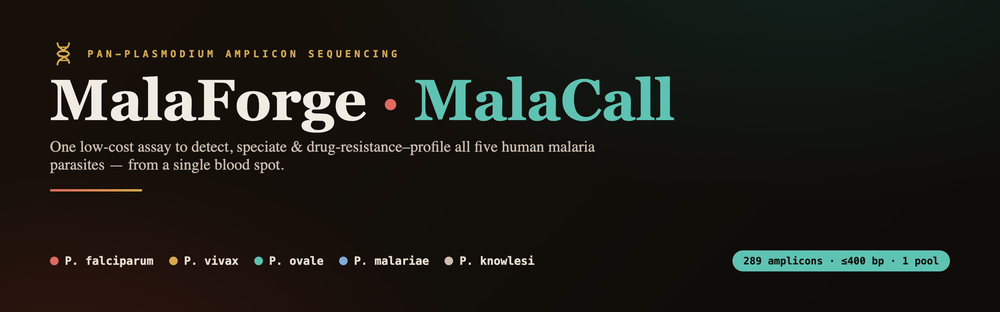
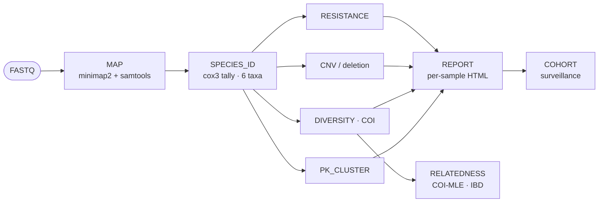

<!-- banner -->


<p align="center">
  <a href="#"></a>
  <a href="#"></a>
  <a href="#"></a>
  <a href="#"></a>
  <a href="#validation"></a>
  <a href="#"></a>
</p>

<p align="center"><b>One low-cost (~$1–10/sample) amplicon-sequencing assay for <i>all five</i> human malaria parasites.</b><br>
Detect · speciate · drug-resistance-profile · genotype diversity — from a single dried blood spot.</p>

---

**MalaForge** designs the panel; **MalaCall** analyses the data it produces. Together they cover all six
taxa — *P. falciparum, P. vivax, P. ovale curtisi, P. ovale wallikeri, P. malariae, P. knowlesi* — in one
platform-agnostic, single-pool assay.

| | Tool | What it does | CLI |
|---|------|--------------|-----|
| 🧬 | **MalaForge** | Panel **design** — 289 amplicons (species ID · resistance · CNV/deletion · diversity), ≤ 400 bp, single pool | [`malaforge`](#malaforge--design) |
| 🔬 | **MalaCall** | End-to-end **analysis & reporting** — Nextflow + Python, per-species attribution, native COI + relatedness | [`malacall`](#malacall--analysis) |

## Highlights

- **All 5 species / 6 taxa** in one assay, with mixed-infection resolution and **per-species** resistance calls.
- **Platform-agnostic**: every amplicon ≤ 400 bp → runs on **Oxford Nanopore, Illumina (2×250), and MGI**.
- **Comprehensive readout**: drug-resistance genotypes with drug interpretation, *pfhrp2/3* deletions (RDT escape),
  gene amplification (CNV), parasite diversity → **complexity-of-infection**, *P. knowlesi* subpopulation typing,
  and cohort-level **COI (MLE) + relatedness** with THE REAL McCOIL / Dcifer exports.
- **Reference-is-mutant polarity** handled correctly (e.g. *pmdhfr* 58/114).
- **Low cost**: ~$5.86/sample on ONT at optimum multiplexing; see the [cost model](docs/cost_model.html).
- **Validated 62/62** against simulated ground truth across every module.

## Pipeline



## Install

Use an environment with `pysam`, `numpy`, `pandas`, `minimap2`, `samtools` (and `nextflow` on `PATH` for
`malacall run`). From the repository root:

```bash
pip install -e .          # installs the malatools package → the `malaforge` + `malacall` commands
malacall --version
malacall --help
```

### MalaCall — analysis

```bash
malacall manifest                                              # one-time: build the amplicon manifest
malacall samplesheet --platform ont --run-dir RUN --out samples.csv
malacall run --samplesheet samples.csv --outdir results --platform ont
malacall cohort      results my_survey                         # surveillance roll-up
malacall relatedness results my_survey                         # cohort COI + relatedness
malacall validate                                              # simulate → run → score (62/62)
```

`malacall run` wraps Nextflow — it sets `JAVA_HOME`, selects the interpreter, and translates friendly flags to
the workflow's params, so you never call `nextflow` by hand. Add `--dry-run` to preview the command.

### MalaForge — design

```bash
malaforge --help
malaforge assemble          # tail (CS1/CS2), screen dimers, pool the panel
malaforge ispcr …           # in-silico PCR validation
malaforge check-barcodes    # barcode / primer / genome conflict checks
malaforge fetch-refs        # download the raw genomes for design (see refs/README.md)
```

> **Note:** the panel itself — primer sequences, the ordering/cost workbook, and the design dossier — is
> held **privately** during proposal review and is **not** included in this repository. Available on request.

## Panel at a glance

| Module | Purpose |
|--------|---------|
| Species ID | mitochondrial *cox3*, all 6 taxa + mixed infections |
| Resistance | per-species drug-resistance markers across the six taxa |
| Diagnostic / CNV | RDT-escape deletions and gene-amplification (copy number) |
| Diversity | microhaplotypes → complexity-of-infection, relatedness, *P. knowlesi* subpopulation |

A single platform-agnostic panel (all amplicons ≤ 400 bp, one pool, no human off-target). The full panel
composition, primer sequences and design rationale are held privately during proposal review.

## Cost (indicative, at each platform's optimum)

| Platform | Samples/run | $/sample |
|----------|:-----------:|:--------:|
| **ONT MinION** | 384 | **$5.86** |
| MGI DNBSEQ-G99 | 192 | $9.51 |
| Illumina MiSeq v2 | 96 | $18.00 |

Full interactive cost + turnaround model: [`docs/cost_model.html`](docs/cost_model.html).

## Validation

`malacall validate` regenerates simulated known-truth reads, runs the full pipeline, and scores every output
against ground truth: **62 / 62 assertions passing** across species ID (incl. mixed), resistance (incl.
reference-is-mutant polarity), CNV, deletion, COI, Pk-cluster, COI-MLE and relatedness.

## Layout

```
malatools/     malaforge / malacall CLI package (pip installs this)
analysis/      MalaCall — main.nf, nextflow.config, bin/*.py, MANUAL.md, test/
design/        MalaForge — design_*.py, assemble_panel.py (panel data kept private)
refs/          pan_reference.fa.gz (committed) + fetch script for raw genomes
targets/       codon maps, ortholog tables
order/         ordering + cost workbook
docs/          pipeline DAG, library construct, cost model
```

Raw per-species genomes are git-ignored (large, public) — restore them with `malaforge fetch-refs`
(see [`refs/README.md`](refs/README.md)). Full pipeline manual: [`analysis/MANUAL.md`](analysis/MANUAL.md).

## Citation

If you use MalaForge / MalaCall, please cite this repository — see [`CITATION.cff`](CITATION.cff).

## License

[MIT](LICENSE).

---

> ⚠️ **Research use only.** In-silico designed and validated on simulated data; wet-lab validation is pending.
> Not a diagnostic device and not for clinical decision-making.
